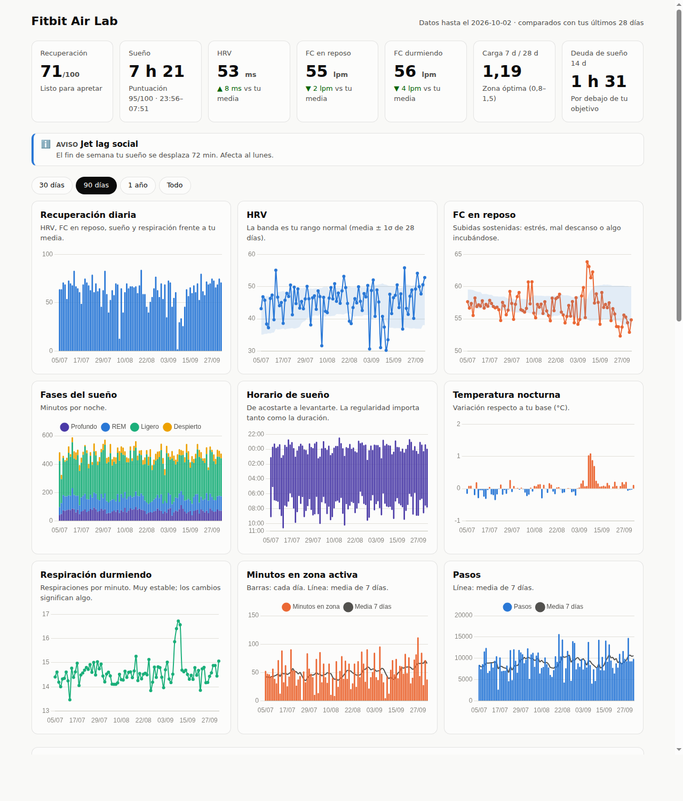

# Fitbit Air Lab

Tus datos de la **Google Fitbit Air**, fuera de la app y a otro nivel: se descargan de la
**Google Health API** a una base de datos local y se analizan contra **tu propia línea base**,
no contra medias genéricas.

Qué te da:

| Función | Qué hace |
|---|---|
| **Recuperación diaria (0–100)** | Combina HRV (40 %), FC en reposo (30 %), sueño (20 %) y respiración (10 %), cada una comparada con tus últimos 28 días. |
| **Puntuación de sueño** | Duración frente a tu objetivo, eficiencia, % de profundo+REM y regularidad del horario. |
| **Alerta temprana** | Avisa cuando se juntan 2 o más señales: FC en reposo alta, HRV baja, temperatura nocturna alta, respiración alta o FC durmiendo alta. Suele adelantarse 1–2 días a un resfriado o a un pico de estrés. |
| **Carga de entreno** | Ratio agudo/crónico (7 d / 28 d) de los minutos en zona activa, para detectar sobrecarga o pérdida de forma. |
| **Deuda de sueño y jet lag social** | Cuánto sueño te falta en 14 días y cuánto se desplaza tu horario el fin de semana. |
| **FC durmiendo** | A partir de la FC intradía: media y mínimo durante la noche. |
| **Diario de hábitos** | Anotas alcohol, café tarde, cena tarde, estrés... y ves su efecto real en tu HRV y tus fases de sueño. |
| **Correlaciones** | Qué hábitos del día se relacionan con tu noche y tu mañana siguiente. |
| **Panel HTML** | Gráficos interactivos con modo oscuro y adaptados al móvil. |
| **Avisos al móvil** | Resumen o alertas por ntfy o Telegram. |
| **Exportación a CSV** | Para Excel, Python o para pasárselo a una IA. |

> ⚠️ Son heurísticas personales de seguimiento, **no diagnósticos médicos**.



## Pruébalo sin conectar nada

```bash
pip install -e .
fitbit-air demo              # 120 días de datos sintéticos realistas
fitbit-air today             # resumen en la terminal
fitbit-air report --open     # panel en el navegador
```

Los datos se guardan en `~/.fitbit-air/` (puedes cambiarlo con `FITBIT_AIR_HOME`). Para
empezar con tus datos reales, borra antes `~/.fitbit-air/health.db`.

## Conectar tu Fitbit Air (una sola vez, unos 10 minutos)

La Google Health API es el sustituto oficial de la antigua Fitbit Web API. Necesitas un
proyecto propio en Google Cloud. Es gratis para uso personal.

1. Entra en <https://console.cloud.google.com/> y crea un proyecto (por ejemplo, `fitbit-air-lab`).
2. **APIs y servicios → Biblioteca**: busca **Google Health API** y pulsa *Habilitar*.
3. **APIs y servicios → Pantalla de consentimiento de OAuth** (en la consola nueva se llama *Google Auth Platform*):
   - Tipo **Externo**. Déjala en modo **Prueba**.
   - En *Usuarios de prueba*, añade tu propia cuenta de Google (la de la pulsera).
   - En *Acceso a los datos* (o *Scopes*), añade:
     - `https://www.googleapis.com/auth/googlehealth.activity_and_fitness.readonly`
     - `https://www.googleapis.com/auth/googlehealth.health_metrics_and_measurements.readonly`
     - `https://www.googleapis.com/auth/googlehealth.sleep.readonly`
4. **Credenciales → Crear credenciales → ID de cliente de OAuth**, tipo **Aplicación de escritorio**.
   Descarga el JSON.
5. En tu ordenador:

```bash
fitbit-air setup ~/Descargas/client_secret_XXXX.json
fitbit-air login             # se abre el navegador, aceptas y listo
fitbit-air sync --days 180   # primera descarga (luego es incremental)
fitbit-air inspect           # comprueba de qué campo sale cada métrica
fitbit-air report --open
```

> Con la app en modo *Prueba*, Google caduca el permiso cada 7 días: si `sync` falla por
> autenticación, repite `fitbit-air login`.

## Uso diario

```bash
fitbit-air sync && fitbit-air report      # actualizar datos y panel
fitbit-air today                          # resumen rápido

# Diario de hábitos (cuanto más constante, mejores conclusiones)
fitbit-air log alcohol                    # hoy
fitbit-air log cafe_tarde cena_tarde --day ayer
fitbit-air log estres=4 --note "entrega del proyecto"
fitbit-air unlog alcohol --day ayer

fitbit-air export mis_datos.csv           # todo en un CSV diario
fitbit-air config sleep_target_min 480    # objetivo de sueño (por defecto 450 = 7 h 30)
```

Ideas de etiquetas que suelen dar resultados claros: `alcohol`, `cafe_tarde`, `cena_tarde`,
`pantallas_cama`, `entreno_noche`, `estres`, `siesta`, `viaje`, `enfermo`, `magnesio`,
`sauna`, `meditacion`.

## Avisos en el móvil

**ntfy** es lo más fácil: instala la app ntfy en el móvil y suscríbete a un tema con un
nombre difícil de adivinar.

```bash
fitbit-air config ntfy_topic mi-tema-secreto-8f3k2
fitbit-air notify                 # envía el resumen de hoy
fitbit-air notify --only-alerts   # solo si hay alertas importantes
```

**Telegram**: crea un bot con @BotFather y configura `telegram_token` y `telegram_chat_id`.

### Automatizarlo (cron en Linux o macOS)

```cron
# Cada mañana a las 8:15: sincroniza, regenera el panel y manda el resumen
15 8 * * *  fitbit-air sync && fitbit-air report && fitbit-air notify
# Cada 3 horas: avisa solo si aparece una alerta importante
0 */3 * * * fitbit-air sync --intraday-days 1 && fitbit-air notify --only-alerts
```

En Windows puedes hacer lo mismo con el Programador de tareas.

## Datos que se descargan

| Métrica | Tipo de la API |
|---|---|
| FC en reposo, HRV, respiración, SpO2, temperatura nocturna, VO2 máx | `daily-*` |
| Pasos, distancia, calorías, minutos en zona activa, minutos activos | `dailyRollUp` |
| Sueño con fases (profundo, REM, ligero, despierto), horarios y siestas | `sleep` |
| Entrenamientos | `exercise` |
| FC minuto a minuto (últimos 14 días por defecto) | `heart-rate` |

Los tipos que tu pulsera no registre se saltan con un aviso, sin romper nada.

### Una nota sobre los campos de la API

Los nombres de algunos campos de los tipos diarios (HRV, respiración, temperatura) no están
documentados públicamente con detalle. El programa busca el valor numérico más probable y
guarda qué campo ha usado. Después de la primera sincronización, ejecuta:

```bash
fitbit-air inspect --raw daily-heart-rate-variability daily-sleep-temperature-derivations
```

Si alguna métrica sale de un campo que no tiene sentido, ajusta las palabras clave en
`fitbit_air/normalize.py` (`DAILY_TYPES` / `ROLLUP_TYPES`).

## Estructura

```
fitbit_air/
  auth.py       OAuth con Google (PKCE, redirección local)
  api.py        Cliente de la Google Health API v4 (reintentos, paginación)
  sync.py       Descarga incremental y métricas derivadas
  normalize.py  Respuestas de la API -> métricas diarias
  analysis.py   Líneas base, puntuaciones, alertas, correlaciones
  report.py     Panel HTML y resumen de texto
  notify.py     ntfy / Telegram
  demo.py       Datos sintéticos
  cli.py        Comandos
tests/          pytest
```

## Privacidad

Todo se queda en tu ordenador: `~/.fitbit-air/` contiene tu token y tus datos de salud.
El `.gitignore` excluye credenciales, bases de datos y CSV para que no acaben en el
repositorio por error.
